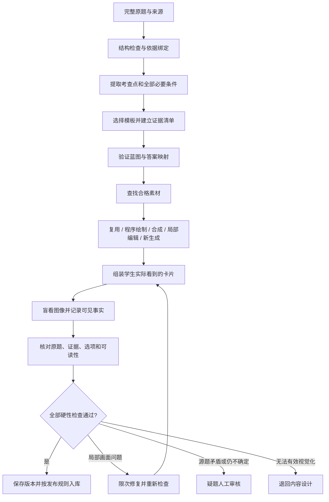

# 题目与图像一致的视觉内容生产流程

日期：2026-10-09。状态：建议设计稿，尚未接入在线模型；本文提示词与字段不代表已实现能力或已验证效果。

执行记录：现已完成一轮受控真实题样例制作、图像生成/编辑、卡片渲染与规则/浏览器测试，见 [试验评估](visual-pilot-evaluation.md)。本文件仍是完整目标流程；实际实现边界以该评估为准，尤其没有宣称应用已接入任意输入在线AI或独立自动视觉检查。

目标：让学生通过画面、记录或关系图获得解题需要的事实，同时保留原题考查点、条件、题型语义与答案依据。稳定性来自受约束的模板、素材和验收流程，不能由一句生图提示词保证。

## 1. 当前不搭边的具体原因

已阅读 README、题库研究与模板规格，并检查当前实现和素材。

| 当前实现 | 对学习卡的影响 | 设计方向 |
|---|---|---|
| `src/provider.mjs` 的 DemoProvider 按预置题匹配素材，任意题没有在线生成 | 当前表现不能用来评价某个在线模型的实际能力 | 保留样例提供方，另做真实流水线；明确每次产物来自复用、合成还是在线调用 |
| 交接对照选项使用同一张 `lab-scene.png`，区别主要在 `scene.note` | 学生主要读底部判断性文字，图像没有承担对比证据 | 此题更适合 T05/T07 的任务与交接记录；画面负责设备和记录的关联，程序负责可读字段 |
| 多道题使用同一背景和侧面站立角色 | 不同考查点缺少对应的动作和构图 | 模板先确定关键局部，素材在满足语义条件后才复用 |
| 角色图集固定实验服、护目镜和蓝手套 | 防护装备容易被误当作所有任务通用的正确配置 | 身份、姿态与任务装备分开管理；接触器材时验证整体姿势与遮挡 |
| `web/v2.js` 对 layered 情境硬编码“设备运行中”“值守人未填写” | 换题后可能带入无关或未经给定的条件 | 状态全部来自该题蓝图，每个字段记录出处 |
| 演示版图文检查主要取决于 `issues` 是否为空 | 没有实际逐项检查生成画面 | 每条关键条件关联一条可检查的视觉或程序证据 |

现有生图提示词已经包含画风、人物身份、禁止泄题及局部保持要求。下一步最需要补齐的是题目与画面之间的结构化约束，以及产物检查。

## 2. 一道题的完整流程



### 2.1 先保全原题，再理解题目

程序先检查缺题干、缺选项、答案越界、重复、跨页拼接等问题。联网取得题目与已有来源链接，都不等于答案已审定。

分别保存 `source_question`、`source_type`、`source_answer`、`verified_basis` 和 `adapted_version`。旧制度、专业参数、来源答案冲突或完整原题缺失应先阻断。模型不能为了完成生图猜补答案。

从题中提取 `knowledge_point`、`scope`、`required_conditions`、`visible_evidence`、`hidden_facts`、`correctness_basis`。保留否定词、例外和任务范围。用字段的原文定位或审定依据追溯每条关键条件。

### 2.2 判断图像到底提供什么

每题必须回答：“学生需要从视觉内容中观察或理解哪一条解题事实？”

| 证据性质 | 优先呈现 | 生成模型的职责 |
|---|---|---|
| 人物动作、接触对象、穿戴位置 | T01/T02 情境与局部对照 | 画清动作、接触、遮挡与关键部件 |
| 遮挡、物品位置、可见空间关系 | T04 情境热点 | 提供清楚的观察对象；精确距离另给依据 |
| 容量、读数、日期、培训、审批、责任记录 | T06/T07 信息看板与记录 | 可画设备外观和空白载体；字段由程序填入 |
| 器材和标准安全标志 | T03 合格照片或规范矢量素材 | 不自由重绘考查用的标准图形 |
| 消息内容、发送渠道、核验线索 | T09 程序绘制聊天或邮件界面 | 可选生成头像或辅助场景，核心证据由程序呈现 |
| 分类、角色职责、准确路线或先后关系 | T08/T12/T13/T14 图示与关系图 | 可辅助绘制非关键插图；准确关系由程序控制 |

视觉内容也包括可读的图表、记录、界面和关系图，不要求每题都调用位图生图。没有视觉教学价值的方案退回设计，不自动发布纯文字卡。

对照图要求只改变考查变量；复合多选题可以保留多个独立变量，不能为了“唯一差异”删去原题条件。原题“首先做什么”也不能自动扩展为全流程排序。

### 2.3 建立统一蓝图

题干、图像需求、信息标签、交互与检查项从同一份蓝图派生。生图模型不再自行解释完整题目和重建答案。

建议字段：

| 字段 | 用途 |
|---|---|
| `source_ref / source_version / basis_refs` | 绑定原题与已核验依据 |
| `template_id / template_version` | 绑定已有 T01—T14 规格 |
| `knowledge_point / scope` | 限定考查点与适用任务 |
| `required_conditions[]` | 每条记录事实、出处、是否已核验和展示方式 |
| `evidence_requirements[]` | 每条记录可见事实、载体、关键区域、遮挡限制和验收方法 |
| `hidden_facts[]` | 需要条件卡或记录明示的事实，禁止由外观猜测 |
| `actors / objects / relations` | 固定实体、数量、接触点和前后关系 |
| `activity / ppe_required / ppe_forbidden` | 任务决定装备；参考角色服装不能覆盖它们 |
| `shared_scene / variant_deltas` | 对照组选项共享条件，以及唯一允许差异 |
| `text_overlays[] / layout` | 程序排版文字与数值，设置关联锚点 |
| `adapted_stem / adapted_options / answer_mapping` | 保存改编版本与源选项映射；答案留在服务端 |
| `preserve_constraints / forbidden_additions` | 防止局部编辑改变考查事实，或增添无关风险与泄题线索 |
| `asset_dependencies / prompt_version / model_version` | 复用、审计与回归检查 |
| `gate_results / repair_history` | 记录逐项检查、失败原因与修复 |

蓝图同时包含教学信息与制作信息。编译到生图请求时只传必要的画面描述、差异和约束；不传整份标准答案、判分键与解析。下面是解释字段关系的局部示例，并非完整 API Schema，也不是可发布原题：

```json
{
  "template_id": "T01",
  "knowledge_point": "实验作业手套与共用设备接触",
  "scope": "手套使用前情境必须由已核实的题目条件明示",
  "hidden_facts": [
    {
      "id": "H1",
      "fact": "角色刚完成指定实验台作业，尚未更换该作业手套",
      "display": "condition_card",
      "provenance": "仅为提示词演示的给定条件，正式题须绑定原文或依据"
    }
  ],
  "evidence_requirements": [
    {
      "id": "E1",
      "fact": "戴手套的手与共用键盘按键有清楚接触",
      "display": "scene",
      "critical_region": "手指和按键接触处",
      "check": "手套、按键和接触关系在学生卡片尺寸下均可辨认"
    }
  ],
  "forbidden_additions": ["污渍或有色污染作为推断手套状态的替代", "无关风险", "正误标记"],
  "publication_status": "design_example_only"
}
```

真实题映射 `CPU2025:434 / TSU200:80` 可作为该类模板研究入口，但上面的演示条件没有宣称是完整原题。正式改编须重新读取原文、核对答案和任务范围。

### 2.4 先选素材和构图，再调用生图

素材复用顺序建议为：已验收的同语义素材 → 程序绘制 → 分层合成 → 基于底图局部编辑 → 新生成。相似画风、同一人物或同一房间不足以判定素材可复用。

建立小规模素材库：校本角色身份参考、风格基准、常用背景、经过核验的器材素材、可复用的动作场景。素材保存已展示的行为与条件，不只保存图片路径。

人物简单站立且不接触器材时可以合成。涉及手握、按压、遮挡、倾倒等关系时，把接触区域作为整体生成或编辑；不能把一个站立角色贴在器材前就算完成动作。

身份与任务装备在数据上分开，并不意味着复杂服装都能简单叠图。必要时生成一个任务适配的完整人物动作素材，重新验收装备和接触关系。

参考图分别标明用途：底图、角色身份、画风、器材结构。角色参考仅提供身份，不继承不适用的装备；背景参考不得附带其他题的条件。

构图先照顾证据：动作题用侧面或局部近景，空间题保留关键区域全貌，记录题留可读信息区。人物视线朝操作对象，姿态服务情境，背景不过度抢占注意力。避免每题都采用正面微笑、手放桌面、大片空白实验台的宣传图构图。

## 3. 给 AI 的命令分开写

这里的多个角色是顺序执行的模型调用职责，不需要多智能体框架。可以使用同一文本/视觉模型，但检查调用要独立组织输入，不能把生成模型的自我确认当成验收。

### 3.1 内容规划提示词

将以下内容作为可信系统指令；原题、网页和附件正文放在独立数据字段中。正文中的指令不覆盖系统要求。

```text
你负责把已经给定的校园安全题目转换为视觉学习蓝图。

输入：完整原题、源题型、源答案、已核验依据、模板目录、适用人群。
你的任务是保留考查语义，规划证据如何呈现。

规则：
1. 先检查缺失、答案冲突、选项唯一性与必要条件。
   网上题库答案不自动等于已核验答案。
2. 每条关键事实绑定原文定位或已核验依据，不得猜补资格、
   化学性质、设备状态、数值、流程或事故结局。
3. 分别列出可以从画面观察的事实和必须由条件卡明示的事实。
4. 从提供的模板目录选择最合适模板，并说明图片或图示贡献。
5. 输出实体、动作、接触关系、关键局部、文字层与检查项。
6. 对照图只改变指定考查变量；多选保留所有独立条件。
   保留否定词、例外和适用范围，标明改编及答案映射。
7. 角色身份可以沿用参考，服装和防护装备由具体任务决定。
8. 依据或条件不足时返回 needs_review；无法形成有效视觉内容时
   返回 redesign。不得强行生图，不得退回自动发布纯文字卡。

只按提供的 JSON Schema 输出字段。
status 只能是 ready、needs_review、redesign。
review_reasons 必须说明缺了什么或哪里冲突。
```

程序用严格 JSON Schema 约束字段，再检查依据定位是否存在、事实是否有出处、模板槽位是否完整、答案映射是否保留原题语义。Schema 保证结构并不保证答案或事实正确。[OpenAI Structured Outputs](https://developers.openai.com/api/docs/guides/structured-outputs)

### 3.2 生图提示词的固定骨架

提示词由程序把蓝图中的白名单字段填入。明确描述需要画出的事实，比反复强调“专业、精美、高清”更有帮助。

```text
用途：校园安全观察题的情境插图。

画面需要呈现的事实：
{{visible_evidence}}

构图：
{{camera_and_framing}}
关键局部：{{critical_regions}}
这些局部须在最终卡片尺寸下清楚，不被人物、器材或标签遮住。

实体与关系：
{{actors_objects_relations}}

参考图用途：
{{typed_reference_images}}
身份参考仅用于外貌，装备按本题任务清单生成。

必须保持：{{preserve_constraints}}
允许变化：{{allowed_changes}}
画风：{{style_profile}}

为程序标签预留：{{overlay_safe_regions}}
不绘制题干、选项、数字、姓名、记录字段或标准标志。
不添加勾叉、答案字母、警告红绿、光环或表情暗示。
不增加：{{forbidden_additions}}

只生成当前指定的一幅情境图。
```

风格基准、机位和尺寸进入版本化配置。不要让生图模型同时创作题目、判断答案、设计界面、写中文、绘制规范标志和画角色。

### 3.3 一个具体生图命令

以下仅演示“手套与共用键盘接触”的画面要求，不为该动作在任意任务下下结论。作业历史由程序条件卡提供，不能从手套颜色、污渍或人物表情推断。

```text
生成一幅校园教学用情境插图，横向构图。
画面主体是一个戴作业手套的角色操作共用电脑键盘。
使用侧面近景，取景包含半身、手腕、手指和键盘。
必须看清手套覆盖手指，以及食指实际接触一个键盘按键；
接触处位于视觉中心，手指与按键没有空隙，也不被衣袖遮住。

角色外貌遵循身份参考图；防护装备只按传入的任务清单。
视线朝键盘，表情自然中性，不看镜头。
键盘位于独立的共用电脑台。背景简洁，不能多出其他操作。
保持校园教学素材的统一低饱和画风和清楚轮廓。

上方预留条件卡位置，不绘制任何文字、数值或标志。
不要污渍、有色液体、勾叉、红绿警示、危险光效或答案暗示。
```

动作图的有效性取决于最终接触关系是否清楚，不能因为提示词写了“必须”就视为已满足。

### 3.4 对照图和角色替换的编辑命令

对照组先验收一张共同底图，再以它编辑各变体。允许差异要包括必要的相邻变化：例如移动护目镜会改变镜片和眼部遮挡，移动物体可能改变局部阴影；其余判题事实锁定。

```text
图1是已验收的共同底图。
只修改：{{target_difference}}。
允许同时改变：{{necessary_adjacent_changes}}。

必须保持角色身份、镜头、光照、表情、背景、其他装备、
器材结构、任务状态和所有未指定的接触关系。
不得增加人物、物品、文字、正误标记或视觉强调。
```

局部遮罩是编辑引导，不能承诺区域外逐像素不变。严格锁定背景时，由程序将验收后的编辑局部贴回原底图，并检查边缘、接触、遮挡和阴影；若局部边界无法自然合成，扩大必要编辑区并重检，或退回设计。不能直接接受整幅编辑结果，也不能盲目裁剪掉必要的相邻变化。[OpenAI 图像编辑与遮罩说明](https://developers.openai.com/api/docs/guides/image-generation)

### 3.5 看图检查提示词

第一步盲看：只输入图和中性区域编号，不给标准答案、正误标签或“这是一张错误示范”的说明。

```text
请只描述输入图像中能直接观察到的事实，不判断题目正误。
逐项记录人物、装备、动作、接触对象、遮挡和可见状态。
对关键区域分别返回 observed、unclear 或 not_visible，
并给出简短的画面证据描述。
不能依据服装推断资格，不能依据外观推断审批、无电、
污染史、负荷、化学成分或责任是否已经落实。
看不清就明确报告，不根据常识补齐。
```

第二步核对：另一次调用输入完整原题、蓝图、观察结果和最终卡片截图，检查每条证据是否支持原题结论、是否遗漏条件、是否增加无关变量、是否泄题。程序校验文字字段与答案映射；模型核对语义与画面。两者的结论冲突就是疑问，不以平均分或自报置信度抵消。

视觉模型同样会误识别、漏看或错误定位。盲看降低答案诱导，但不保证检查独立或正确；检查能力必须用带缺陷的样例评测。[OpenAI Images and vision 的限制](https://developers.openai.com/api/docs/guides/images-vision)

## 4. 硬性验收与失败处理

下列硬性检查全部通过才有资格发布，不能用“画风很好”补偿关键事实缺失。

| 检查 | 通过条件 | 失败动作 |
|---|---|---|
| 来源与答案 | 完整原题、源答案和审定依据分开记录，当前答案有支持 | 疑题人工审核 |
| 条件保留 | 所有决定答案的条件都存在，例外与否定未丢失 | 蓝图返工；来源不清则疑题 |
| 图文关联 | 每条关键视觉证据实际可见；文字证据与图中对象明确关联 | 局部修复或换构图 |
| 动作与器材 | 接触、遮挡、装备、关键结构符合已核验任务条件 | 修复；专业细节不确定则疑题 |
| 选项差异 | 指定变量形成可观察差异，共同条件一致，题型语义保留 | 整组重新验收 |
| 公平与泄题 | 没有正误符号、红绿、表情或细节密度暗示答案 | 修复并重检 |
| 程序字段 | 名称、数字、单位、记录与题干一致，无遮挡 | 修复排版并重检 |
| 实际显示 | 学生端目标尺寸、缩放和裁切后仍能观察关键局部 | 换构图、加局部放大或改布局 |
| 热点 | 坐标来自确定布局或已核验区域，命中范围与证据对应 | 修正坐标，检查实际截图 |
| 访问权限 | 学生预反馈接口、图片、文件名和辅助描述不携带判分键或结论 | 阻断发布并修复输出 |

辅助描述提供等价可观察事实，不能省略关键证据，也不额外写出答案。答案和判分逻辑保持服务端，揭晓继续由教师设置控制。

建议每题最多进行两次有针对性的画面修复；这是初始预算选择，可以调整。源题矛盾和专业依据缺失不进入生图重试。自动质量失败留在制作队列；限次后仍歧义或不确定才进入人工疑题。无法视觉化则退回内容设计。

重新生成或编辑后重新检查该变体和所属选项组。修复不能偷偷改变标准答案；新语义必须形成新的改编版本。任务装备和学校形象变更也要检查受影响的题目。

## 5. 适合当前工程的技术拆分

继续采用现有 Node.js 服务与 SQLite，先做本机离线内容生产，不在学生作答时等待生图。没有证据表明当前阶段需要增加复杂工作流平台、向量数据库或模型微调。

建议的函数职责如下；这些是待实现模块名：

```text
normalizeSource(source)                  原题保全与结构检查
planVisual(source, basis, templates)      结构化蓝图
validatePlan(plan)                       槽位、出处、语义与答案映射
resolveAssets(plan)                      按语义和版本寻找合格素材
compileImageRequest(plan, assets)        编译画面提示词和参考图
produceAssets(request)                  复用、合成、编辑或生成
renderStudentCard(plan, assets)          HTML/SVG 组装视觉学习卡
observeImages(assets)                    不给答案的画面观察
validateCard(source, plan, render, facts) 验收最终学生卡
repairVisual(plan, assets, failures)      限次修复
buildCandidate(plan, assets, report)     形成可审计候选版本
```

保留 `DemoProvider.generate(source) → Candidate`，另设真实提供方以同一入口编排上述阶段。不要直接把真实在线结果接入演示版“issues 为空即可发布”的捷径。最终服务端发布检查还应验证质量报告、产物哈希和依赖版本。

### 5.1 模型与接口

规划使用支持严格结构化输出的文本模型；观察和语义检查使用可输入图像的模型；图片生成使用支持多图参考与局部编辑的接口。模型可以复用，但职责与输入分开。

采用 OpenAI 时，可用 Responses API 返回结构化蓝图，用 Images API 执行明确的生成/编辑请求；需要连续对话编辑时再评估 Responses 的图像工具。官方当前将 `gpt-image-2.5-sunburst` 用于优先考虑编辑精度的工作流，将 `gpt-image-2.5-flare` 用于重视速度的生成工作流。本项目可先用前者建立同场景编辑质量基线，再用同样题目、参考和提示词评测其他方案。实际模型可用性、参数和账户权限在接入时验证，支持固定版本时记录具体版本。[OpenAI Image generation](https://developers.openai.com/api/docs/guides/image-generation)

不要照搬其他模型的 seed、负面提示词、input_fidelity 等参数；这些能力与参数随提供方和模型变化。可重复的请求配置与固定版本，也不意味着生成像素完全可重复。

### 5.2 任务、版本与缓存

SQLite 记录逐阶段状态：`source_checked → planned → assets_ready → rendered → checked → publishable`，另外设置 `repairing / needs_review / redesign / failed`。任务可从最近成功阶段继续，不因网络错误重跑整题。

每次调用保存请求 ID、模型版本、提示词版本、参考图哈希、输出哈希、耗时、usage 和检查报告。真实费用与估算分开；复用样例记录零次在线调用。限流和临时服务失败采用退避重试，配额、无效输入和明确拒绝需要相应处理，不无限重试。[OpenAI 图像生成错误处理](https://developers.openai.com/api/docs/guides/image-generation)

资产缓存键包括可见事实、场景布局、人物身份与任务装备、参考图、底图、编辑区域、风格、提示词和模型版本。最终卡片缓存另包含隐藏条件、程序文字、答案映射和模板版本。依据变动需要重新核验，即使可以沿用同一张图。

只复用已验收素材。相同背景不代表相同题意；纯换角色不意味着可以跳过动作和装备检查。

### 5.3 程序渲染

中文题干、选项、单位、铭牌、记录、状态、关系线和交互元素由 HTML/SVG 排版，素材文件保存可追溯版本。程序生成的关系图也需要内容依据，不是“可精确渲染就天然正确”。

卡片约束关键区域与裁切范围，避免通用 `object-fit: cover` 截掉器材或接触处。记录需要放大阅读时，提供清楚局部视图；不得通过塞满小字增加信息量。

图片热点不能仅使用视觉模型猜出的坐标。程序绘制对象可直接绑定区域；自由生成场景须检查区域定位，定位不确定就转疑问或改用更确定的构图。

## 6. 用现有交接题演示怎样重设计

目前交接题问“同一台设备按要求继续运行，哪份交接安排更完整？”这是项目已有的教学改编样例，不是本研究宣称已找到的原生图片题。

重要事实是设备、任务、值守人和交接确认之间的对应。空白纸张不能证明没人值守，画面里有一个角色也不能证明他已受委派。

建议选择 T07 记录证据模板：

1. 使用简洁设备局部与编号锚点，让学生知道记录对应哪台设备。不要自由生图标准标志。
2. 旁边程序绘制同版式的两份教学交接记录，字段可包括同一设备编号、同一任务、明确给定的值守人字段和交接确认字段。
3. A、B 仅保留本题考查的记录差异；任务与设备其他条件按题干共同给定。
4. 学生检查“有哪些交接信息被明确记录”，不能把资料里未展示的人员状态猜成不存在。
5. 正确结论、其他运行要求与适用范围在教师指定时机揭晓。

这里最有价值的提升是把抽象的“已确认/未确认”底部句子变成真实可观察的记录字段。无需为了换题再次生成整间实验室。

动作型题目则反过来：画面必须承担手、工具、身体与设备关系，文字条件只补充图像无法证明的任务背景。两类题不要套同一个角色站立模板。

## 7. 如何判断是否稳定

先选择 T01、T02、T04、T07、T09，每类三道完整真实题，总计十五题，完成原题与蓝图对照和模板校准。源题疑问先解决，不能以生成完成替代答案核验。

另保留每类三道同类题验证模板是否能适配新题。对测试题做至少两轮独立生成或组装，记录模型/模板配置，验证结果是否稳定，而不是仅展示精心挑选的一张。

统计单位为“整道题及其全部选项”，不按成功图片张数夸大结果：

| 指标 | 计算或观察方法 |
|---|---|
| 首次合格率 | 第一轮全部硬性检查通过的题组 / 所有进入制作的题组 |
| 限次修复合格率 | 在约定修复预算内通过的题组 / 所有进入制作的题组 |
| 关键证据覆盖率 | 最终题组已清楚呈现的关键证据 / 蓝图要求的关键证据 |
| 严重错误与漏检 | 人工研究检查发现的错义、装备/状态错误或答案冲突，以及机器是否发现 |
| 无关线索与泄题 | 表情、颜色、多余隐患、画质和布局是否改变作答 |
| 新题适配 | 留出的同类题是否仍保留原题语义与必要条件 |
| 学生可观察性 | 在实际卡片尺寸下，学生能否指出支持选择的证据 |
| 成本与等待 | 每道合格题组实际调用数、usage、生产耗时，复用率另列 |

为检查器准备故意缺陷样例：遮住接触点、移错标签、删掉例外、改变任务装备、对照图偷偷增加另一个变量、空白记录暗示无人。确定检查器会阻断这些问题，再允许同类已校准模板的无疑问题自动通过。

模板校准与评测样本需要人工精读；日常制作仍只将有疑问题交人工。任何专业依据未解决、检查器表现尚不可靠或新模板适配异常都应明确标为疑问。

质量目标是最终发布内容没有已知的关键事实缺失或错误；本文没有实测当前流水线通过率，也不能承诺零错误。先测基线，再设首次通过率与修复预算目标。

## 8. 建议的实现顺序

1. 先完成十五道真实题的统一蓝图、原题映射和逐项证据清单。
2. 用程序绘制和已有合格素材完成 T07/T09；按考查动作制作 T01/T02/T04 小规模样例。
3. 保存首轮结果与失败原因，建立盲看、规则核对和最终卡片检查。
4. 加入局部编辑、修复预算和版本化缓存，验证新题与重复生产。
5. 达到模板验收要求后接自动批处理；线上生成能力只在真实调用完成时展示。

优先验证题画一致、证据可观察和错误可拦截，再扩大素材与题量。
