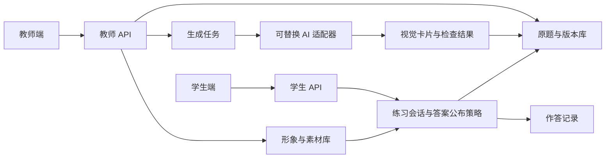

# 知安校园安全学习技术设计
研究修订：模板协议见 [config/card-templates.json](../config/card-templates.json)。当前新增 `sequenceEvidence` 发布门槛和共享 `web/drag-sort.js`，支持鼠标、触屏、键盘。只有 `approved`、`originalQuestionRef`、`originalType`、`currentProcedureRef`、`scope`、`precedenceVerified` 齐全时才能发布排序题；不能在普通审核表里通过补答案绕过。此前事故时间线不满足门槛。14份模板是内容规格，不表示14类自动生成器已完成。

版本 0.2，2026-10-09。本文区分已实现和下一阶段设计，供前后端继续开发。

## 架构
当前采用 Node.js HTTP 服务、SQLite 和原生 HTML/CSS/JavaScript，运行时无第三方依赖。界面在 /teacher 与 /student，API 分别在 /api/teacher 和 /api/student。



当前生成队列在单进程内执行，任务状态持久化。进程中断后任务标记失败，可重试；不宣称具有跨实例队列能力。更大规模时可迁移到 PostgreSQL、对象存储和独立任务队列，先保持接口不变。

## 认证与权限
- 两端独立登录，随机会话令牌，HttpOnly、SameSite=Strict Cookie；分别限定到角色 API 路径。
- 教师会话可读原题与答案，学生接口通过字段白名单返回公开卡片。
- 学生练习按服务端认证身份归属，不接受客户端自报 clientId 来读取他人数据。
- 登录会话保存在内存，服务重启需重新登录；学习会话在数据库中保留。
- 旧 /api/state 和逐题公开答案接口已不再提供。
- 当前演示账号共用学生口令，正式部署需独立账号、密码管理或学校 SSO，并补充限流、HTTPS、审计和授权测试。

## 数据实体
| 实体 | 当前存储 | 关键字段 |
|---|---|---|
| 原题及候选 | questions | source、candidate、status、version、history |
| 版本快照 | revisions | question_id、version、body |
| 任务 | jobs | ids、total、completed、status、errors |
| 学习会话 | learning_runs | owner、cards 快照、settings 快照、selections、results |
| 作答 | attempts | questionId、version、runId、choice、correct、topic、clientId |
| 学校配置 | settings | feedback、batchSize、characterId、version |
| 上传形象 | character_profiles | reference、views、status、version |

内置角色元数据在 src/provider.mjs。图片在 web/assets，上传参考在 assets/uploads。角色与题库历史材料均不写入原舆情工作区。

## 视觉卡片协议
候选卡片至少包含：
```json
{
  "type": "hotspot",
  "stem": "请选择需要核查的区域",
  "options": [{"text":"区域名称"}],
  "answer": [0],
  "visual": {"kind":"layered","image":"assets/lab-scene.png","pose":"quarter"},
  "markers": [{"label":"区域名称","x":18,"y":51}],
  "caseInfo": {"url":"https://学校官网/事故通报","kind":"原通报"},
  "explanation": "答案依据",
  "issues": [],
  "provider": "demo-fixture-v2"
}
```
这是教师/服务端结构；学生答题接口删除 answer、explanation、caseInfo 等可提前揭题信息。案例出处在答案揭晓后出现。

| type | selection 格式 | 判分 |
|---|---|---|
| image_choice / image_judge / illustrated | 选项索引 number | 精确相等 |
| multi / hotspot | 不重复索引数组 | 集合完全相等 |
| order | 全部索引的排列 | 顺序完全相等 |
| branch | 两次决策的索引数组 | 当前样例按完整路径相等 |

当前分支样例具有一个根节点与两条后续路径。通用分支树后续应改为 nodeId/edgeId、有向无环图及终点评分规则，不能把当前两步交互当成任意复杂图已完成。暂不提供部分分，避免不同卡片分数口径混杂。

## 答案公布
开始练习时冻结题目版本、学校形象和公布策略。
- batch：selection 接口只返回 saved 和 answered。支持回改。完成全部后 submit 在事务内判分并写作答记录。
- each：selection 接口返回该题 feedback，随后锁定该题。未作答题的答案仍不返回。
- submit 对已提交会话幂等，不能重复累加成绩。
- 同一用户恢复练习时 batch 不返回 results；each 只返回已确认题的 results。
- 教师撤回或修订题后，旧会话继续保存/提交会被阻止，提示重新开始，保留历史快照。
- 学生点击提交前先保存当前改动，避免已保存题再次修改后交卷遗漏。

## 内容生成与校验
适配器契约为 generate(sourceQuestion) → Candidate。当前为预生成样例，任意新题并未调用模型。

真实流水线设计：
1. 原题解析与依据绑定，保留来源文本和原答案。
2. 提取考查点、场景条件和必要视觉信息。
3. 在视觉卡片类型中路由；无法可靠视觉化时退回内容设计，不发布纯文字卡。
4. 生成场景结构描述与图片需求；先查素材复用。
5. 生成图片或局部编辑；视觉模型检查关键行为及选项一致性。
6. 规则检查答案范围、唯一性/多选逻辑、原题一致性、来源有效性。
7. 汇总疑问并自动分流，只有有疑问的交给教师。

不以模型自报置信度作为唯一通过条件。模型失败、信息不足、图文歧义、来源冲突应明确标记。真实提供方需补充 JSON Schema 验证、超时、重试、计费与请求 ID；当前演示具备任务失败保留和重试入口，尚未完成全部在线边界。

## 形象素材管线
输入：教师上传参考图、名称、形象来源及版本。当前支持 PNG/JPEG 参考保存；内置两套角色已生成正面、侧面、背面。

目标输出 CharacterPack：
```json
{
  "characterId":"school-character",
  "version":1,
  "referenceHash":"sha256",
  "styleVersion":"lab-3d-v1",
  "views":[
    {"angle":"front","pose":"standing","assetId":"...","alpha":true},
    {"angle":"quarter","pose":"standing","assetId":"...","alpha":true},
    {"angle":"back","pose":"standing","assetId":"...","alpha":true}
  ],
  "qualityStatus":"passed"
}
```
后续可加入侧面双向、手持、指示、行走等姿态，按场景需要生成，避免一次盲目生成大量视图。面部、服装、防护器材和比例需要一致性检查。视图推测不能当作原角色三维事实。

## 两种角色替换
### 图层复用
背景、人物、前景遮挡、文字标签与热点分层。每个角色槽记录位置、缩放、角度、姿态及允许遮挡区域。更换同姿态角色不调用生图；UI 使用透明 atlas，标签与热点坐标仍独立。

本轮已实现：透明角色 atlas＋固定背景、三视角预览、两角色切换、新学习会话应用统一角色。当前场景是二维教学合成，不是物理精确三维重建。

### 局部编辑
复杂接触场景输入原图、角色参考、目标区域、必须保持的器材结构和判题条件。输出候选图后核验：
- 手与器材的接触点、手指数和握持方式；
- 前后遮挡及尺寸比例；
- PPE、阀门状态、容器标签等关键判题信息；
- 背景、热点、答案是否发生变化。

本轮实际使用内置图像编辑工具生成了“蓝色角色双手持箱 → 橙色小狐双手持箱”的对照，人工看图确认握持和箱体保持合理。工具采用参考图与限定提示词；没有显式像素遮罩，也不保证修改区域外逐像素完全一致。应用端载入已生成结果，不是假装实时请求。

正式局部重绘适配器建议支持 maskAssetId、protectedRegions、referenceAssetIds、preserveConstraints，以及编辑前后质量报告。若关键行为变化，生成新题目/图像版本并进入疑题处理。

## 复用与成本
本轮静态素材可重复使用；尚未实现生产级内容寻址缓存或真实费用统计。建议的缓存键：
```text
hash(sceneVersion + characterVersion + view + pose + styleVersion
     + protectedObjects + questionVisualConstraints + modelVersion)
```
先精确复用，再图层合成，最后局部编辑或重生。更换角色即使场景相同，也必须把角色版本纳入键，避免错误命中。失败产物、未核验产物不能进入“可发布”缓存。

记录实际生成次数、重试次数、人工审核时间、延迟和费用，不承诺固定降本百分比。局部重绘是否便宜取决于服务计费与失败返工；它首先减少重新设计场景的工作。

## 待实现
在线文字/视觉/生图服务，任意参考图多视图生成，任意场景遮罩编辑，图像自动验收，文档 OCR/解析，正式账号与部署，通用分支树，变式与间隔复习。

