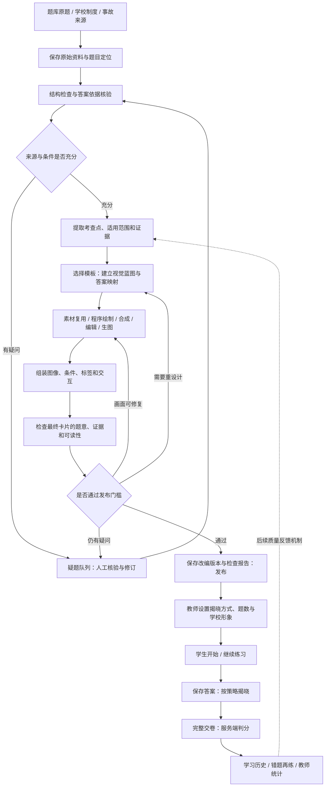
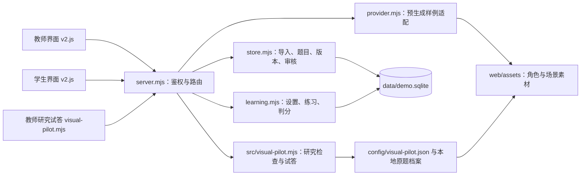

# 知安校园安全学习：项目全链路

整理日期：2026-10-10。依据项目文档、当前代码、演示数据库只读查询和研究样例检查结果整理。研究工作量与制作记录来自2026-10-09报告。

项目目标是把有出处、有依据的校园安全题转成能观察、能操作的视觉学习内容，由教师管理题库和教学设置，学生练习后留下可追溯的作答记录。当前优先级是验证真实题与视觉模板的适配质量。

## 1. 总链路与当前进度

下面是完整目标链路。图中的生成、检查与发布能力须结合后面的现状表理解。



| 环节 | 当前实际状态 | 下一步缺口 |
|---|---|---|
| 来源研究 | 精读6份题库中的651条来源记录，含重复；有来源登记与阅读日志 | 扩大覆盖前先核验选用题的答案、条件和适用依据 |
| 模板设计 | 14类规格与预览已产出 | 将已验证模板变成可复用的制作与检查模块 |
| 真实题制作 | 15道首批设计、3道补充适配、6道疑题；实际7次生图/编辑 | 更充分的新题适配与重复生产验证 |
| 内容检查 | 研究样例有来源、映射、条件、哈希和审查记录检查；内容与看图核对由同一操作者完成 | 独立视觉检查、专业依据核验和检查器评测 |
| 教学发布 | 固定演示样例支持发布、疑题审核、撤回、版本保存 | 真实题研究数据到教学候选的转换，以及完整发布门槛 |
| 教师管理 | 登录、导入、任务、审核、设置、角色预览、数据汇总已实现 | 任意输入在线制作、正式账号和部署能力 |
| 学生学习 | 保存、恢复、两种揭晓策略、交卷、历史、错题再练已实现 | 正式填空/简答支持、通用分支、间隔复习等 |
| 质量反馈 | 有正确率、知识点统计与研究试答 | 学生反馈回到内容修订的完整流程尚未实现 |

## 2. 当前运行的两条链路

### 2.1 教学演示链路

```text
教师导入 JSON 或约定格式文本
→ 输入校验与相同结构内容去重
→ 保存原题 questions.source
→ 创建制作任务 jobs
→ DemoProvider 匹配并复用固定样例
→ 保存候选 questions.candidate
→ 演示规则通过则发布，有疑问则进入 review
→ 教师修订通过 / 退回 / 撤回
→ 学生读取已发布视觉卡
→ 保存、交卷、判分
→ learning_runs / attempts
→ 历史、错题和教师统计
```

这条链路已经连通。目前非归档样例7道，其中5道已发布、2道待审核；另有5道旧题归档。待审内容包括旧自编事故时间线与条件不足的样品包装题。

`DemoProvider` 按固定原题内容匹配素材，不调用在线模型。任意新题可保存原文，但没有对应视觉设计时进入待处理/疑题，不能据此宣称自动改题成功。演示的自动检查也不能当作真实模型的质量检验。

正式导入器目前要求每题有2—8个选项，保存题干、选项、答案、解析、主题、来源标题与链接。研究使用的原题型、页码、原编号、档案哈希、条件出处等完整字段还没有统一接入教学导入协议；填空和简答也尚未接入这条教学链路。

### 2.2 真实题研究链路

```text
取得来源文件并记录哈希
→ 提取原文、编号、页码、选项和源答案
→ 逐题阅读，登记阅读范围和疑问
→ 选择模板，人工策划视觉蓝图
→ 保留原题快照、条件出处和答案映射
→ 实际生图/编辑，或 HTML/SVG 程序绘制
→ 观察关键动作并与来源比对
→ 共同底图合成、条件标签和交互渲染
→ 检查内容指纹、素材哈希和证据记录
→ 教师研究试答、浏览器检查和评估报告
```

这条链路产出18道可试答样例，覆盖8类模板和单选、多选、判断、填空、简答五种原作答语义；另有6道疑题保持阻断。当前只读重算结果为15道首批、3道补充样例通过研究预览检查，6道疑题进入待核验。

研究预览的通过不代表专业审定或生产发布资格。该批正式发布0道，应用在线生成0次，独立自动视觉检查尚未实现。研究试答不写正式作答记录，也不修改教师的正式教学设置。

研究记录保存在本地原题档案、配置和报告中。当前没有从研究页一键导入或发布到教学库的完整实现；接通时需要转换数据协议、继承来源与版本，并执行更完整的发布检查。

## 3. 一道题从原文到视觉卡

### 原题保全与检查

分别保存原始来源、原题型、源答案、核验依据与改编版本。原库答案仅是输入，遇到缺答案、答案越界、选项冲突、旧制度或专业参数不确定时，先处理疑问。

来源定位要包含文件、页码或正文序位，题号不能单独充当全局主键。导入去重与阅读记录计数分开，下载数量不能当作精读数量。

### 模板与蓝图

先明确考查点、任务范围、全部必要条件、可见事实、隐藏事实和答案依据，再从T01—T14选择呈现方式。蓝图关联题干、选项、图像、标签、交互和检查项。

| 知识证据 | 对应模板举例 | 制作重点 |
|---|---|---|
| 可见动作、接触和穿戴 | T01判断、T02对照 | 画清实际动作，保留任务装备条件 |
| 区域与空间关系 | T04热点、T12路线 | 明确区域和空间依据，校验热点与布局 |
| 任务条件、读数和记录 | T05清单、T06参数、T07证据 | 状态与字段可读，不用外观猜隐藏事实 |
| 器材识别、分类和职责 | T03识别、T08分类、T14关系 | 规范素材、分类依据和制度范围 |
| 消息、条件变化和复杂案例 | T09聊天、T10决策、T11案例 | 保留渠道、前提、角色关系和多个正确行动 |
| 已核验的先后关系 | T13拖排 | 完整原题、现行流程依据、适用范围和先后约束 |

原题型与模板分开记录。多选保持多选语义，填空和简答不能静默转成选择；必要改编须标明原因并保存答案映射。并行清单与“首先做什么”不能擅自扩写成全流程排序。

### 素材与渲染

优先查找满足本题事实的合格素材，随后选择程序绘制、分层合成、局部编辑或新生成。中文、数字、记录、单位与关系线由程序排版；标准安全标志使用规范资源。

背景、身份、任务装备、动作、道具、标签和热点分别管理。简单站立场景可换角色图层；握持、接触、遮挡复杂的场景需生成或编辑完整接触区域，再检查。角色参考不能覆盖本题的防护要求。

对照题使用共同底图并限制允许差异。本轮已经发现整图编辑会导致背景漂移，因此最终对照卡采用程序固定背景、覆盖动作区域的方式。

### 检查、修复与发布

目标检查包括来源与依据、条件保留、答案映射、视觉证据、装备与器材、选项差异、泄题线索、文字可读性、实际显示和学生接口权限。

画面问题先在制作环节修复并重检；来源矛盾、专业依据缺失或持续歧义才进入人工疑题；无法形成有效视觉内容则退回设计。不能用无关插图或纯文字卡补位。

研究样例现已绑定检查记录与素材版本，但这些记录不等于自动语义或视觉裁决。后续真实提供方不能直接沿用演示端“issues为空即发布”的捷径。

## 4. 教师、形象与学生链路

教师登录 `/teacher`，管理原题、制作任务、疑题、发布状态、学校设置与学习汇总。正常题按已验证门槛流转，人工主要处理疑题。教师选择逐题/整组揭晓、每组1—20题及学校形象，默认整组5题。

形象是一条并行素材链：上传参考图 → 保存形象档案 → 多视图/动作素材 → 任务装备适配 → 卡片使用与检查。目前上传只保存参考，内置两套形象已有预生成视图和替换样例；任意新形象的视图生成与场景编辑尚未接入。

学生登录 `/student` 后开始、继续练习或重练错题。服务器只选已发布且满足门槛的视觉题，开组保存题目与教学设置快照，练习归属绑定登录身份。当前按固定题库顺序截取每组题数，尚未实现轮换、随机或自适应组题。

| 揭晓方式 | 保存答案后 | 交卷后 |
|---|---|---|
| 整组 | 只返回保存状态，可回改；恢复时不返回答案 | 全部完成后统一判分，显示答案、解析和依据 |
| 逐题 | 确认后返回本题反馈并锁定；未答题答案仍隐藏 | 完成全部题后统一写入成绩记录 |

交卷在事务内写入学习结果与作答记录，重复交卷不重复增加成绩。题目撤回或版本变更后，旧练习继续保存/提交会被阻止。教师设置变化作用于新练习组。

历史记录可以继续未完成练习或查看已提交解析；错题再练按已提交记录中各题的最近结果筛选。教师看到完成作答、正确率和知识点汇总。当前没有完整间隔复习算法或学习效果验证。

研究试答的填空只有固定别名接受规则，不确定表述显示对照；简答为参考要点自评。两者都不能称为通用AI判分。

## 5. 代码与数据对应



| 文件或目录 | 责任 |
|---|---|
| [server.mjs](../server.mjs) | HTTP服务、角色鉴权、教师/学生接口、单进程任务执行、静态页面 |
| [src/store.mjs](../src/store.mjs) | 原题校验与去重、状态、版本、任务、审核、撤回、统计 |
| [src/provider.mjs](../src/provider.mjs) | 固定样例候选与预生成形象素材适配 |
| [src/learning.mjs](../src/learning.mjs) | 学校设置、练习快照、保存、判分、提交和错题筛选 |
| [src/sequence-policy.mjs](../src/sequence-policy.mjs) | 排序题发布与使用门槛 |
| [web/v2.js](../web/v2.js) | 当前教师与学生界面；入口HTML实际加载此文件 |
| [web/drag-sort.js](../web/drag-sort.js) | 鼠标、触屏拖排与键盘操作 |
| [config/card-templates.json](../config/card-templates.json) | 14类模板规格；不代表14个在线生成器 |
| [config/visual-pilot.json](../config/visual-pilot.json) | 真实题研究蓝图、映射和检查依赖 |
| [src/visual-pilot.mjs](../src/visual-pilot.mjs) | 研究来源/证据检查、研究预览与试答评价 |
| `research/question-banks/`、`research/visual-pilot/` | 本地原始文件与完整原题快照，排除Git与公开打包 |
| `web/assets/` | 当前渲染使用的位图素材与上传参考 |
| `docs/research/` | 来源登记、阅读日志、模板、制作方案与评估报告 |
| `test/`、`scripts/verify-*.mjs` | 临时数据库下的服务与浏览器验证 |

SQLite分别保存题目 `questions`、版本快照 `revisions`、制作任务 `jobs`、练习 `learning_runs`、作答 `attempts`、学校配置 `settings` 和上传形象 `character_profiles`。原始内容与候选改编分别放在 `source` 和 `candidate`。

运行入口为 `node server.mjs`，默认 `http://127.0.0.1:4185`。当前是Node.js原生HTTP、SQLite与HTML/CSS/JavaScript的本机开发演示，登录会话在内存，学习数据持久化。

工作目录固定为 `D:/project/aixuexiaozhili`，远程保持 `https://github.com/acetaffyace/aixuexiaoanquanzhili.git`；`.migration-backup/`不作为开发或业务数据目录。

## 6. 后续衔接顺序

1. **先完成内容核验与模板验证。** 对准备使用的真实题核验答案、前提与现行依据，扩大同类新题测试，记录失败与修复；仍有疑问的题保持阻断。
2. **统一研究与教学数据协议。** 让教学候选携带原题型、完整定位、源答案、核验依据、改编版本、条件出处、素材依赖与检查记录，补齐填空/简答等语义差异。
3. **接入真实制作与检查能力。** 在现有提供方入口后实现结构化规划、素材选择、实际生成/编辑、最终卡片渲染、独立观察与核对、限次修复，记录真实调用与成本。
4. **接通受控发布。** 服务端校验来源、语义、素材哈希、检查记录和依赖版本，合格内容进入教学库，只有疑题进入人工处理。
5. **再验证课堂使用与部署。** 以真实学生验证证据可观察性和学习效果，再完善账号、学校认证、多人部署与复习策略。

这轮文档整理只做代码阅读、数据库只读查询与研究检查重算。既有验证报告记录核心/研究测试10项通过及72组研究页面布局检查；本轮没有重新执行这些测试。

## 7. 依据与详细文档

- [项目说明](../README.md)
- [真实题库研究](research/question-bank-study.md)
- [14类模板规格](research/template-catalog.md)
- [视觉内容目标生产流程](research/image-generation-pipeline.md)
- [真实题视觉试验评估](research/visual-pilot-evaluation.md)
- [需求文档](需求文档.md)、[技术设计](技术设计.md)、[后端接口](后端接口.md)
- [排序题依据与启用条件](research/order-evidence.md)
- [既有验证记录](验证记录.md)
